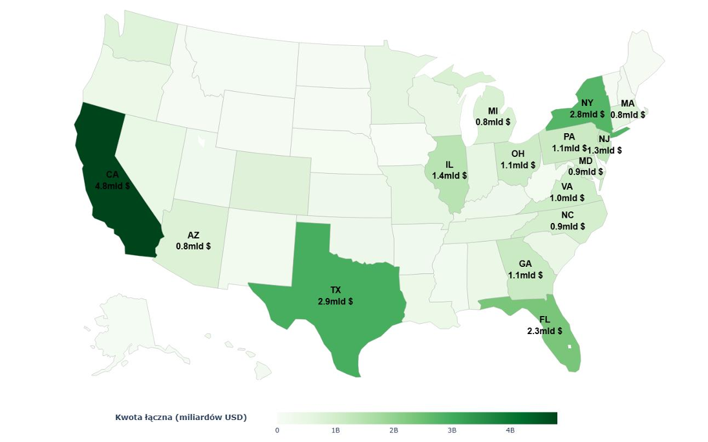
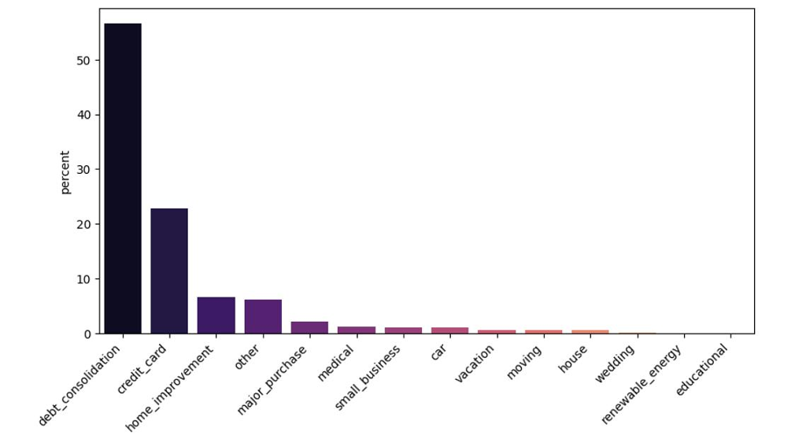
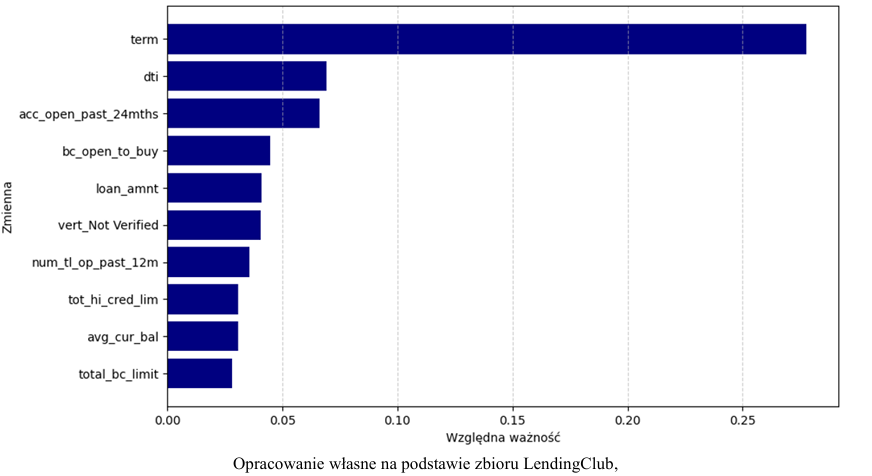
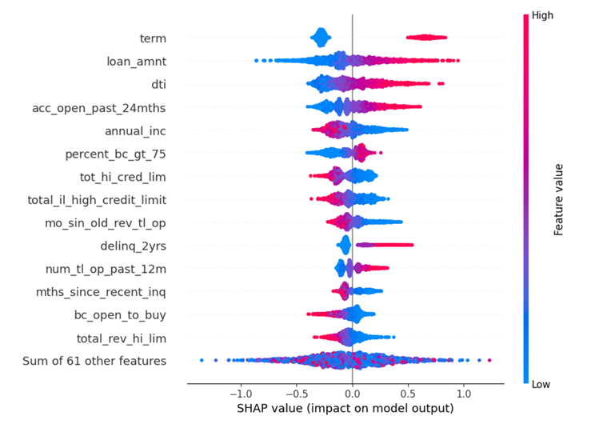

  
  

# Application of Machine Learning Methods and Econometrics in Credit Risk Modeling of P2P Loans
### Bachelor's Thesis in Economic Analytics

**Author:** Filip Gorczyca  
**Affiliation:** Department of Quantitative Methods in Social Sciences, Krakow University of Economics (UEK)  
**Supervisor:** Dr. Sebastian Baran

---

## Project Overview & Research Objective
This repository contains the empirical code and full text of my Bachelor's thesis investigating credit default prediction on the peer-to-peer (P2P) lending market under conditions of **information asymmetry**, **adverse selection**, and **moral hazard**.

Using historical data from the US fintech platform **LendingClub** (over `2.26 million` initial records and `145` attributes), the study constructs an end-to-end credit scoring and decision-support framework from scratch—relying strictly on borrower application data and credit bureau history available at the moment of loan origination, while excluding LendingClub's proprietary risk grades (`grade`, `sub_grade`, `int_rate`) to avoid building a "model on top of a model."

### Core Research Hypothesis
Widely accessible dichotomous classification tools—spanning classical econometric **Logistic Regression (Logit MLE)** and machine learning algorithms (**CART Decision Tree, Random Forest, and XGBoost**)—effectively identify high-risk borrowers and, when paired with expected-profit cutoff optimization ($p^*$), minimize capital losses from non-performing loans.

---

## Exploratory Data Analysis (LendingClub Portfolio, 2007–2018)

  
   
  <em>Figure 1: Geographic concentration of total originated loan volume (in USD billions) across top US states, led by California ($4.8B), Texas ($2.9B), New York ($2.8B), and Florida ($2.3B).</em>

  
   
  <em>Figure 2: Distribution of declared borrowing purposes. Debt consolidation (58.12%) and credit card refinancing (21.92%) account for ~80% of all applications.</em>

---

## Data Engineering & Anti-Leakage Protocol
1. **Target Definition (`target`):** Filtered for completed loan contracts (`1,303,638` records), encoding `Fully Paid` as `0` (`1,041,952` loans / `79.93%`) and `Charged Off` + `Default` as `1` (`261,686` loans / `20.074%` default rate; 4:1 class imbalance). Ongoing loans (`Current`, `In Grace Period`, `Late`) were excluded.
2. **Missingness Cutoff & Structural Truncation:** Removed columns with $>20\%$ missing values (reducing dimensionality from 145 to 87 columns). Truncated early platform incubation years prior to **September 2012** (`issue_d >= '2012-09-01'`) where credit bureau attributes exhibited structural missingness, yielding a final clean sample of **`1,235,283` loans** and **`72` explanatory features**.
3. **Target Leakage Elimination:** Systematically audited all variables against Pearson correlations with `target` and the data dictionary to strip post-origination servicing and recovery fields (`recoveries` $r=0.499$, `collection_recovery_fee` $r=0.473$, `total_rec_prncp` $r=0.441$, `last_pymnt_amnt`, `out_prncp`, `hardship_flag`, `debt_settlement_flag`) as well as platform-assigned pricing (`int_rate`, `installment`, `grade`, `sub_grade`).
4. **Feature Engineering:**
   * Constructed credit history length in months (`cr_history_months`) as the exact difference between loan origination (`issue_d`) and first credit line (`earliest_cr_line`).
   * Transformed employment length (`emp_length`) into a discrete scale (`0–10` years) and applied One-Hot Encoding to nominal variables (`home_ownership`, `verification_status`, `purpose`), dropping reference categories (`home_MORTGAGE`, `purpose_debt_consolidation`, `vert_Not Verified`) in the Logit specification to prevent the dummy variable trap.
5. **Out-of-Time Chronological Split (60% / 20% / 20%):** Sorted strictly by `issue_d` to mirror real-world credit underwriting and prevent temporal look-ahead bias:
   * **Training Set (60%):** `741,169` observations
   * **Validation Set (20%):** `247,057` observations (used via `PredefinedSplit` in `RandomizedSearchCV`)
   * **Test Set (20%):** `247,057` observations (out-of-time evaluation; missing values across all splits imputed exclusively with training-set medians).

---

## Empirical Results & Model Comparison

| Model | Training AUC-ROC | Test AUC-ROC (Out-of-Time) | Generalization Gap ($\Delta$ AUC) | Key Specification / Hyperparameters |
| :--- | :---: | :---: | :---: | :--- |
| **XGBoost (Gradient Boosting)** | **0.7531** | **0.7109** | 0.0422 | `n_estimators=1500`, `max_depth=7`, `lr=0.02`, `subsample=0.8`, `colsample_bytree=0.8`, `reg_alpha=0.5`, `reg_lambda=2`, `scale_pos_weight=4` |
| **Logistic Regression (Logit MLE)** | 0.7078 | 0.6833 | **0.0245** | `statsmodels` MLE, 72 features, Pseudo $R^2_{\text{McF}} = 8.96\%$, LLR $p < 0.001$ |
| **Random Forest** | 0.7224 | 0.6829 | 0.0395 | `n_estimators=300`, `max_depth=10`, `min_samples_leaf=100`, `max_features='log2'`, `class_weight='balanced_subsample'` |
| **Decision Tree (CART)** | 0.6971 | 0.6494 | 0.0476 | `max_depth=8`, `min_samples_split=10`, `min_samples_leaf=20`, `criterion='gini'` |

---

## Model Interpretability (Econometric Odds Ratios, Random Forest & SHAP)

* **Econometric Inference (Logit MLE):** The top statistically significant risk drivers by $\vert{}z\vert{}$-statistic are loan maturity `term` ($z = 149.82$, $\beta = 0.9328$, Odds Ratio $e^{0.9328} \approx 2.54$ — 60-month loans carry a **154% higher odds of default** than 36-month loans ceteris paribus), debt-to-income ratio `dti` ($z = 71.17$, $\beta = 0.0286$, Odds Ratio $1.029$ per 1 pp increase), `loan_amnt` ($z = 52.79$), and recently opened accounts `acc_open_past_24mths` ($z = 46.09$).
* **Tree-Based Feature Importance & Explainable AI (SHAP):**

  
   
  <em>Figure 3: Top 10 most influential predictors in the Random Forest model based on Gini impurity reduction.</em>

  
   
  <em>Figure 4: SHAP Beeswarm summary plot for the best-performing XGBoost model, illustrating both global feature importance and the directional impact of feature values on default log-odds.</em>

---

## Business Cutoff Optimization ($p^*$) & Portfolio Profit Maximization
In P2P lending, the cost of a **False Negative** (granting a loan to a defaulting borrower, incurring an 80% Loss Given Default, $\text{LGD} = 0.80$, average loss `$11,500`) vastly exceeds the opportunity cost of a **False Positive** (average interest gain `$2,077`).

To translate probability predictions into an actionable underwriting policy on the out-of-time test set ($N = 247,057$), expected portfolio profit was simulated across probability cutoffs $p^*$:
$$R_i = \begin{cases} \text{loan\_amnt}_i \times \text{int\_rate}_i & \text{if } \text{target}_i = 0 \\ -\left(\text{loan\_amnt}_i \times \text{LGD}_{\text{score}}\right) & \text{if } \text{target}_i = 1 \end{cases}$$

| Cutoff Threshold ($p^*$) | Originated Loans | Portfolio Net Result (USD) | Recall (Default Capture) | Specificity (Good Loan Approval) |
| :---: | :---: | ---: | :---: | :---: |
| `0.100` | 6,481 | +$3,660,078 | 99.78% | 3.17% |
| `0.200` | 30,150 | +$13,977,769 | 97.56% | 14.69% |
| **`0.287` (Optimal)** | **61,338** | **+$20,667,561** | **92.02%** | **29.47%** |
| `0.300` | 66,527 | +$19,758,453 | 91.02% | 31.58% |
| `0.400` | 109,689 | +$8,569,206 | 78.93% | 50.59% |
| `0.500` (Standard) | 153,598 | -$28,060,800 | 61.51% | 68.49% |

* **Strategic Conclusion:** Applying a naive `0.50` threshold results in a **`-$28.06M` loss**. Fine-tuning the rejection cutoff to **$p^* = 0.287$** blocks **92.02% of all defaults** (`49,123` true positives vs. only `4,260` false negatives) and maximizes gross portfolio profit at **`+$20,667,561`** across `61,338` approved loans.

---

## Repository Contents
| File | Description |
| :--- | :--- |
| [`LendingClub_Credit_Risk_Modeling.ipynb`](./LendingClub_Credit_Risk_Modeling.ipynb) | Complete Jupyter Notebook: data cleaning, anti-leakage filtering, feature engineering, chronological splitting, XGBoost/RF/CART `RandomizedSearchCV`, SHAP analysis, and `statsmodels` Logit MLE. |
| [`bachelor_thesis.pdf`](./bachelor_thesis.pdf) | Full 76-page Bachelor's thesis (in Polish): theoretical framework, exploratory analysis, mathematical derivations, and empirical evaluation. |
| **Dataset Source** | [LendingClub Loan Data on Kaggle](https://www.kaggle.com/datasets/adarshsng/lending-club-loan-data-csv) |
