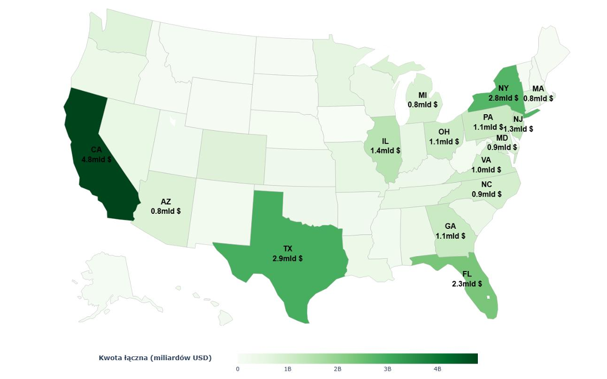
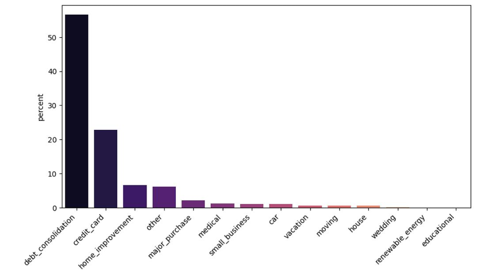
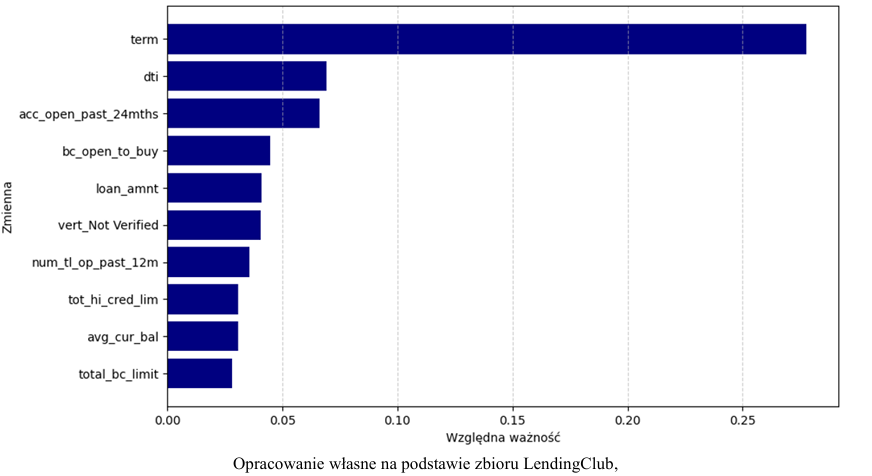
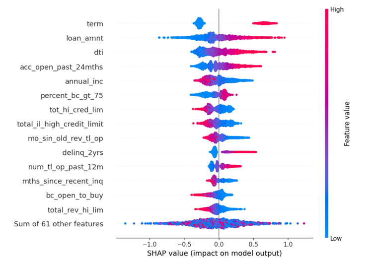

  
  

# Wykorzystanie metod uczenia maszynowego oraz ekonometrii w modelowaniu ryzyka kredytowego pożyczek społecznościowych
### Praca licencjacka na kierunku Analityka Gospodarcza

**Autor:** Filip Gorczyca  
**Afiliacja:** Instytut Metod Ilościowych w Naukach Społecznych, Uniwersytet Ekonomiczny w Krakowie (UEK)  
**Promotor:** dr Sebastian Baran

---

## Opis projektu i cel badawczy
Repozytorium zawiera kod źródłowy oraz pełny tekst pracy licencjackiej poświęconej predykcji ryzyka niewypłacalności (defaultu) na rynku pożyczek społecznościowych (peer-to-peer lending) w warunkach **asymetrii informacji**, **negatywnej selekcji** oraz **pokusy nadużycia**.

W części empirycznej wykorzystano dane historyczne amerykańskiej platformy fintech **LendingClub** (ponad `2,26 mln` surowych rekordów i `145` zmiennych). Celem badania było zbudowanie od podstaw systemu scoringowego wspierającego decyzje kredytowe wyłącznie na podstawie cech społeczno-ekonomicznych oraz historii z biura kredytowego znanych w momencie składania wniosku — z całkowitym pominięciem wewnętrznych ocen ryzyka nadawanych przez platformę (`grade`, `sub_grade`, `int_rate`), aby uniknąć budowy „modelu na podstawie modelu”.

### Hipoteza badawcza
Ogólnodostępne narzędzia stosowane w modelowaniu zmiennych dychotomicznych — klasyczny model ekonometryczny **regresji logistycznej (Logit MNW)** oraz algorytmy uczenia maszynowego (**drzewo decyzyjne CART, las losowy Random Forest oraz wzmacnianie gradientowe XGBoost**) — pozwalają na skuteczną identyfikację ryzykownych pożyczkobiorców, a w połączeniu z optymalizacją progu odcięcia ($p^*$) umożliwiają minimalizację strat kapitałowych portfela.

---

## Eksploracyjna analiza danych (Portfel LendingClub, 2007–2018)

  
   
  <em>Ilustracja 1: Koncentracja geograficzna łącznej kwoty pożyczek (w mld USD) w poszczególnych stanach USA – liderami są Kalifornia (4,8 mld USD), Teksas (2,9 mld USD), Nowy Jork (2,8 mld USD) oraz Floryda (2,3 mld USD).</em>

  
   
  <em>Wykres 1: Struktura deklarowanych celów pożyczkowych. Konsolidacja zadłużenia (58,12%) oraz refinansowanie kart kredytowych (21,92%) odpowiadają łącznie za blisko 80% wszystkich wniosków.</em>

---

## Inżynieria danych i eliminacja zjawiska Data Leakage
1. **Definicja zmiennej objaśnianej (`target`):** Wyfiltrowano zakończone kontrakty pożyczkowe (`1 303 638` wierszy), kodując status `Fully Paid` jako `0` (`1 041 952` pożyczek / `79,93%`) oraz połączone statusy `Charged Off` i `Default` jako `1` (`261 686` pożyczek / `20,074%` – proporcja klas 4:1). Pożyczki w trakcie spłaty (`Current`, `In Grace Period`, `Late`) zostały wykluczone.
2. **Redukcja braków danych i ucięcie strukturalne:** Usunięto kolumny posiadające powyżej 20% braków danych (redukcja ze 145 do 87 zmiennych). Odrzucono wczesną fazę inkubacji platformy przed **wrześniem 2012 r.** (`issue_d >= '2012-09-01'`), w której występowały masowe braki strukturalne w raportach biura kredytowego, uzyskując finalną próbę **`1 235 283` pożyczek** i **`72` zmiennych objaśniających**.
3. **Eliminacja wycieku danych z przyszłości (Data Leakage):** Na podstawie macierzy korelacji Pearsona ze zmienną `target` oraz słownika zmiennych usunięto wszystkie cechy aktualizowane po wydaniu pożyczki i w trakcie windykacji (`recoveries` $r=0,499$, `collection_recovery_fee` $r=0,473$, `total_rec_prncp` $r=0,441$, `last_pymnt_amnt`, `out_prncp`, `hardship_flag`, `debt_settlement_flag`) oraz parametry wyceny ryzyka platformy (`int_rate`, `installment`, `grade`, `sub_grade`).
4. **Inżynieria cech i kodowanie zmiennych:**
   * Utworzono zmienną długości historii kredytowej w miesiącach (`cr_history_months`) jako różnicę pomiędzy datą wydania pożyczki (`issue_d`) a datą otwarcia pierwszej linii kredytowej (`earliest_cr_line`).
   * Przekształcono staż pracy (`emp_length`) na skalę numeryczną (`0–10` lat) oraz zastosowano kodowanie One-Hot Encoding dla zmiennych nominalnych (`home_ownership`, `verification_status`, `purpose`), usuwając kategorie referencyjne (`home_MORTGAGE`, `purpose_debt_consolidation`, `vert_Not Verified`) w modelu Logit w celu uniknięcia pułapki współliniowości doskonałej.
5. **Chronologiczny podział zbioru (Time Series Split: 60% / 20% / 20%):** Posortowano obserwacje rosnąco według daty wydania pożyczki (`issue_d`), aby odwzorować realne warunki decyzyjne i wykluczyć patrzenie w przyszłość:
   * **Zbiór treningowy (60%):** `741 169` obserwacji
   * **Zbiór walidacyjny (20%):** `247 057` obserwacji (wykorzystany przez `PredefinedSplit` w optymalizacji `RandomizedSearchCV`)
   * **Zbiór testowy (20%):** `247 057` obserwacji (imputacja braków danych we wszystkich podzbiorach została przeprowadzona wyłącznie za pomocą median wyznaczonych na zbiorze treningowym).

---

## Wyniki empiryczne i porównanie modeli

| Model predykcyjny | AUC-ROC (Zbiór treningowy) | AUC-ROC (Zbiór testowy) | Luka generalizacyjna ($\Delta$ AUC) | Specyfikacja / Dobrane hiperparametry |
| :--- | :---: | :---: | :---: | :--- |
| **XGBoost (Wzmacnianie gradientowe)** | **0,7531** | **0,7109** | 0,0422 | `n_estimators=1500`, `max_depth=7`, `lr=0.02`, `subsample=0.8`, `colsample_bytree=0.8`, `reg_alpha=0.5`, `reg_lambda=2`, `scale_pos_weight=4` |
| **Regresja logistyczna (Logit MNW)** | 0,7078 | 0,6833 | **0,0245** | Estymacja MNW (`statsmodels`), 72 zmienne, Pseudo $R^2_{\text{McF}} = 8,96\%$, LLR $p < 0,001$ |
| **Las losowy (Random Forest)** | 0,7224 | 0,6829 | 0,0395 | `n_estimators=300`, `max_depth=10`, `min_samples_leaf=100`, `max_features='log2'`, `class_weight='balanced_subsample'` |
| **Drzewo decyzyjne (CART)** | 0,6971 | 0,6494 | 0,0476 | `max_depth=8`, `min_samples_split=10`, `min_samples_leaf=20`, `criterion='gini'` |

---

## Interpretowalność modeli (Ilorazy szans Logit, Random Forest oraz SHAP)

* **Wnioskowanie ekonometryczne (Logit MNW):** Najsilniejszymi statystycznie stymulantami ryzyka niewypłacalności według statystyki $|z|$ są: okres kredytowania `term` ($z = 149,82$, $\beta = 0,9328$, iloraz szans $e^{0,9328} \approx 2,54$ — wybór okresu 60-miesięcznego zwiększa szansę defaultu o **154%** względem pożyczki 36-miesięcznej ceteris paribus), wskaźnik zadłużenia do dochodu `dti` ($z = 71,17$, $\beta = 0,0286$, wzrost szansy o **2,9%** na każdy dodatkowy punkt procentowy DTI), wnioskowana kwota `loan_amnt` ($z = 52,79$) oraz liczba rachunków otwartych w ostatnich 24 miesiącach `acc_open_past_24mths` ($z = 46,09$).
* **Ważność zmiennych w modelach drzewiastych i dekompozycja SHAP:**

  
   
  <em>Wykres 2: Hierarchia 10 najważniejszych predyktorów w modelu Lasu Losowego (względna ważność na podstawie redukcji nieczystości Giniego).</em>

  
   
  <em>Wykres 3: Wykres SHAP Beeswarm dla zwycięskiego modelu XGBoost, obrazujący globalną istotność cech oraz kierunek ich wpływu na logarytm szans niewypłacalności klienta.</em>

---

## Optymalizacja progu odcięcia ($p^*$) i maksymalizacja wyniku finansowego portfela
W sektorze pożyczek P2P koszt błędu II rodzaju (**False Negative** – udzielenie pożyczki niewypłacalnemu dłużnikowi przy narzuconym wskaźniku Loss Given Default $\text{LGD} = 0,80$, średnia strata `11 500 USD`) jest ponad pięciokrotnie wyższy niż utracone korzyści odsetkowe przy błędzie I rodzaju (**False Positive** – odrzucenie rzetelnego klienta, średni zysk odsetkowy `2 077 USD`).

Na zbiorze testowym ($N = 247\,057$) przeprowadzono symulację wyniku finansowego portfela w zależności od przyjętego progu decyzyjnego $p^*$:
$$R_i = \begin{cases} \text{loan\_amnt}_i \times \text{int\_rate}_i & \text{dla } \text{target}_i = 0 \\ -\left(\text{loan\_amnt}_i \times \text{LGD}_{\text{score}}\right) & \text{dla } \text{target}_i = 1 \end{cases}$$

| Próg odcięcia ($p^*$) | Liczba przyznanych pożyczek | Wynik finansowy portfela (USD) | Czułość (Recall – wykryci dłużnicy) | Swoistość (Specificity – przyjęci rzetelni) |
| :---: | :---: | ---: | :---: | :---: |
| `0,100` | 6 481 | +3 660 078 $ | 99,78% | 3,17% |
| `0,200` | 30 150 | +13 977 769 $ | 97,56% | 14,69% |
| **`0,287` (Optymalny)** | **61 338** | **+20 667 561 $** | **92,02%** | **29,47%** |
| `0,300` | 66 527 | +19 758 453 $ | 91,02% | 31,58% |
| `0,400` | 109 689 | +8 569 206 $ | 78,93% | 50,59% |
| `0,500` (Standardowy) | 153 598 | -28 060 800 $ | 61,51% | 68,49% |

* **Kluczowy wniosek biznesowy:** Zastosowanie domyślnego progu klasyfikacyjnego `0,50` generuje stratę portfela w wysokości **`-28,06 mln USD`**. Kalibracja progu odcięcia na poziomie **$p^* = 0,287$** pozwala wychwycić **92,02% wszystkich bankrutów** (`49 123` poprawnie zatrzymanych dłużników przy zaledwie `4 260` pomyłkach) i maksymalizuje zysk brutto portfela testowego na poziomie **`+20 667 561 USD`** przy `61 338` udzielonych pożyczkach.

---

## Zawartość repozytorium
| Plik | Opis |
| :--- | :--- |
| [`LendingClub_Credit_Risk_Modeling.ipynb`](./LendingClub_Credit_Risk_Modeling.ipynb) | Notatnik Jupyter zawierający pełny pipeline w języku Python: czyszczenie danych, filtrację zmiennych data leakage, inżynierię cech, podział chronologiczny, strojenie modeli XGBoost/RF/CART (`RandomizedSearchCV`), analizę SHAP oraz estymację modelu Logit MNW (`statsmodels`). |
| [`bachelor_thesis.pdf`](./bachelor_thesis.pdf) | Pełny 76-stronicowy tekst pracy licencjackiej zawierający podstawy ekonomiczne rynku P2P, wyprowadzenia matematyczne algorytmów oraz ewaluację empiryczną. |
| **Źródło danych** | [LendingClub Loan Data – Kaggle](https://www.kaggle.com/datasets/adarshsng/lending-club-loan-data-csv) |
